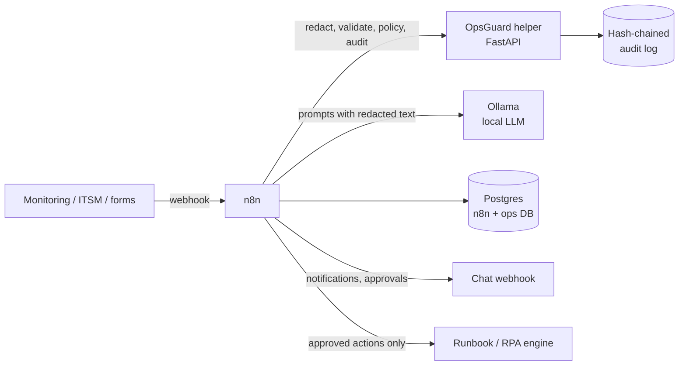
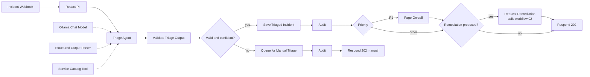
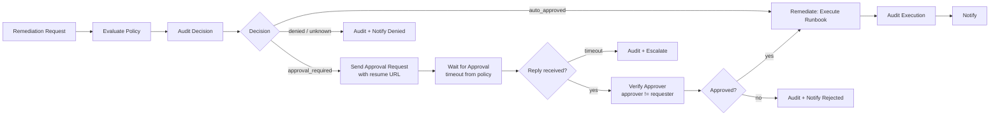
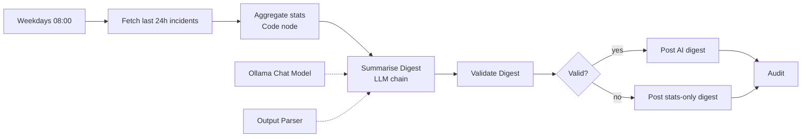
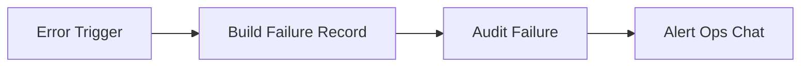

# n8n AI Ops Automation

[](https://github.com/sarathalapad/n8n-ai-ops-automation/actions/workflows/ci.yml)


**AI-assisted IT incident triage and remediation, built on n8n, with the guardrails an enterprise actually needs:** PII is redacted before the model sees anything, every AI answer is validated before it is used, risky actions wait for a second human, and every decision lands in a tamper-evident audit log. It runs fully self-hosted with Ollama, so it can work air-gapped.

Built by **Sarathkumar K**, AI Solutions Architect, drawing on years of intelligent automation and RPA delivery: the same patterns (queues, exception paths, human-in-the-loop, audit) applied to LLM-driven workflows.

---

## What it does

| # | Workflow | Trigger | What happens |
|---|----------|---------|--------------|
| 01 | [Incident intake and AI triage](workflows/01-incident-intake-ai-triage.json) | `POST /webhook/ops/incidents` | Redacts PII, AI agent classifies category / priority / team with structured output, output is validated, then stored and routed (P1 pages on-call). Invalid or low-confidence output goes to a manual triage queue. |
| 02 | [Remediation with human approval](workflows/02-remediation-human-approval.json) | `POST /webhook/ops/remediation` (called by 01) | Policy decides `auto_approved` / `approval_required` / `denied`. Approval requests pause on a Wait node; the approver resumes it; a four-eyes check runs; timeout escalates. |
| 03 | [Daily ops digest](workflows/03-daily-ops-digest.json) | Schedule, weekdays 08:00 | Pulls the last 24h of incidents, computes stats in code, LLM writes the narrative, digest is validated (incl. PII leak check), posted to chat. Falls back to a stats-only post. |
| 99 | [Error handler](workflows/99-error-handler.json) | n8n Error Trigger | Logs any workflow failure to the audit log and alerts the ops chat. |

The workflows call **OpsGuard**, a small FastAPI helper service (`service/`) that holds the logic that has to be correct: redaction, output validation, the action policy, approval checks and the audit chain. It is unit-tested and gated in CI.

## Architecture



### 01 - Incident intake and AI triage



### 02 - Remediation with human approval



### 03 - Daily ops digest



### 99 - Error handler



## Governance design

| Control | Where | Why |
|---------|-------|-----|
| **PII and secret redaction before the LLM** | `POST /v1/redact`, first step of workflow 01 | Emails, phone numbers, Luhn-valid card numbers, IPs, API keys, bearer tokens, `password=` values and private keys are replaced with stable placeholders (`[EMAIL_1]`). The redacted text is what gets stored, so the digest inherits the protection. |
| **Validated AI output** | `POST /v1/validate/triage`, `/v1/validate/digest` | The output parser *asks* for a shape; validation *enforces* meaning: known teams, known actions and services, no PII echoed back, security incidents go to security, confidence threshold. Anything failing goes to a human queue, never "best effort". |
| **Deterministic numbers** | Code node in workflow 03 | Counts are computed in code; the model only writes prose, so it cannot hallucinate statistics. |
| **Policy as code, fail closed** | `POST /v1/policy/evaluate` | Unknown actions are denied, forbidden actions (drop database, disable monitoring, ...) can never be approved through chat, unknown services and tier-1 production always need a human. |
| **Human approval with four-eyes** | Wait node + `POST /v1/approvals/verify` | The requester can never approve their own action; optional approver allow-list; timeout scales with risk and escalates instead of executing. |
| **Tamper-evident audit** | `POST /v1/audit`, `GET /v1/audit/verify` | Each record commits to the previous record's SHA-256, so editing or deleting any record breaks verification. Event payloads are PII-scrubbed before they are written. |
| **Workflow rules enforced in CI** | `scripts/validate_workflows.py` | Fails the build if an AI node's output skips validation, if any path reaches the runbook engine without the approval check or the policy's `auto_approved` branch, if connections are broken, or if a secret or tokenised URL is hardcoded. |
| **Self-hosted / air-gapped option** | Ollama in `docker-compose.yml` | No incident text leaves your network. Swapping in a hosted model is a one-node change (the redaction still applies). |
| **Least exposure** | `docker-compose.yml` | n8n and the helper bind to `127.0.0.1` only; Ollama and Postgres are not published; n8n credentials are encrypted with `N8N_ENCRYPTION_KEY`; webhooks require a header key; no credentials are stored in the workflow files. |

## Quick start

Requires Docker with Compose v2.

```bash
cp .env.example .env            # then replace every placeholder value
docker compose up -d --build
docker compose exec ollama ollama pull llama3.1:8b
docker compose exec n8n n8n import:workflow --separate --input=/workflows
```

Open http://localhost:5678, create the owner account, then create these credentials (the workflows reference them by name):

| Credential name | Type | Value |
|-----------------|------|-------|
| `OpsGuard Helper Token` | Header Auth | name `X-OpsGuard-Token`, value = `OPSGUARD_API_TOKEN` from `.env` |
| `Ops Webhook Auth` | Header Auth | a header name and random key that callers of the incident / remediation webhooks must send |
| `Ollama (local)` | Ollama | base URL `http://ollama:11434` |
| `Ops Postgres` | Postgres | host `postgres`, database `ops`, user/password from `.env` |
| `Runbook API Token` | Header Auth | whatever your runbook / RPA engine expects |

Open each imported workflow, pick the credential in any node that shows a warning, set **Settings -> Error workflow** of 01, 02 and 03 to "Ops 99 - Error handler", and activate them. Then send a test incident:

```bash
curl -X POST http://localhost:5678/webhook/ops/incidents \
  -H "Content-Type: application/json" -H "<your webhook header>: <key>" \
  -d @samples/incidents/01-payments-outage.json
```

### Run the helper service and tests without Docker

```bash
python -m venv .venv && . .venv/bin/activate      # Windows: .venv\Scripts\activate
pip install -r requirements-dev.txt
ruff check . && pytest -q
python scripts/validate_workflows.py
python scripts/simulate.py
```

## Demo transcript

`scripts/simulate.py` replays the decision path of workflows 01, 02 and 03 against the real helper service (in-process), with a deterministic keyword classifier standing in for the LLM. It needs no Docker, model or network. Actual output:

```text
=== 01-payments-outage  [payments-api / production]
  redact      : {'EMAIL': 1, 'CARD': 1, 'PHONE': 1}
                -> Since 09:05 every checkout returns 502 from payments-api. Customer [EMAIL_1] called from [PHONE_
  triage      : P1 application -> team payments (confidence 0.88)
  notify      : paged on-call via chat webhook
  policy      : restart_service on payments-api -> approval_required (medium-risk action in production)
  approval    : requested, Wait node paused for 30 min
  approval    : approve by bob.sre-lead -> ACCEPTED (approved by a second person)
  execute     : runbook 'restart_service' submitted for payments-api

=== 02-vpn-staging  [vpn-gateway / staging]
  redact      : {'IP_ADDRESS': 1}
                -> Engineers on the staging VPN lose connection every ~10 minutes. Gateway [IP_ADDRESS_1] shows int
  triage      : P2 network -> team network (confidence 0.81)
  policy      : run_diagnostics on vpn-gateway -> auto_approved (low-risk action within policy)
  execute     : runbook 'run_diagnostics' submitted for vpn-gateway

=== 03-leaked-credentials  [auth-service / production]
  redact      : {'SECRET': 2}
                -> A developer pasted the auth-service config in a public chat: password=[SECRET_2] and api_key: [S
  triage      : P1 security -> team security (confidence 0.95)
  notify      : paged on-call via chat webhook
  policy      : rotate_credentials on auth-service -> approval_required (high-risk action)
  approval    : requested, Wait node paused for 15 min
  approval    : approve by mei.sec -> REFUSED (approver must be different from requester)

=== 04-vague-report  [no service / production]
  redact      : nothing found
  validate    : REJECTED ['confidence 0.3 below threshold']
  route       : manual triage queue (AI output not used)

=== 05-prompt-injection  [orders-db / production]
  redact      : nothing found
  validate    : REJECTED ["proposed_action.action: unknown action 'drop_database'"]
  route       : manual triage queue (AI output not used)

=== 06-db-primary-down  [orders-db / production]
  redact      : nothing found
  triage      : P1 database -> team database (confidence 0.88)
  notify      : paged on-call via chat webhook
  policy      : failover_database on orders-db -> approval_required (high-risk action)
  approval    : requested, Wait node paused for 15 min
  approval    : TIMEOUT -> escalated to duty manager, nothing executed

=== daily digest
  stats       : {'total': 6, 'manual_triage': 2, 'by_priority': {'P1': 3, 'P2': 1}}
  validate    : OK -> posted: 6 incidents in the last 24h, 3 P1

=== audit log
  verify      : ok=True records=15
  tamper test : edited record 2 -> ok=False first_bad_seq=2 (record content was modified)
```

Things worth noticing: the fake model in sample 05 deliberately *obeys* a prompt injection and proposes `drop_database`; validation rejects it before any policy or action step. In sample 03 the requester tries to approve their own credential rotation and is refused. In sample 06 nobody answers, so nothing runs and the request escalates.

## Helper service API

| Method and path | Purpose |
|-----------------|---------|
| `GET /healthz` | Liveness (no auth) |
| `POST /v1/redact` | `{"fields": {...}}` -> redacted fields + finding counts |
| `POST /v1/validate/triage` | `{"output": <AI output>}` -> `valid`, `errors`, `needs_human_review`, `data` |
| `POST /v1/validate/digest` | Same for the digest summary |
| `GET /v1/schema/triage` | JSON Schema of the triage contract |
| `GET /v1/catalog` | Services, owning teams, tiers (used as an agent tool) |
| `POST /v1/policy/evaluate` | `auto_approved` / `approval_required` / `denied`, risk, reason, timeout |
| `POST /v1/approvals/verify` | Four-eyes check of an approval reply |
| `POST /v1/audit`, `GET /v1/audit/verify` | Append to / verify the hash-chained audit log |

All endpoints except `/healthz` need the `X-OpsGuard-Token` header. If no token is configured, the service returns 503 instead of running open (set `OPSGUARD_DEV_MODE=1` only for local experiments).

## Project layout

```text
.
├── workflows/                   n8n workflow exports (import these)
│   ├── 01-incident-intake-ai-triage.json
│   ├── 02-remediation-human-approval.json
│   ├── 03-daily-ops-digest.json
│   └── 99-error-handler.json
├── service/
│   ├── Dockerfile
│   └── opsguard/                FastAPI helper service
│       ├── main.py              app factory, auth, endpoints
│       ├── pii.py               redaction
│       ├── schemas.py           AI output contracts and validation
│       ├── policy.py            service catalog, action policy, four-eyes check
│       └── audit.py             hash-chained audit log
├── scripts/
│   ├── validate_workflows.py    static workflow checks (CI)
│   └── simulate.py              offline end-to-end demo
├── samples/                     incident payloads and simulated approver replies
├── tests/                       pytest suite
├── db/init.sql                  ops database schema
├── docs/screenshots/            n8n canvas screenshots
├── docker-compose.yml
├── .env.example
└── .github/workflows/ci.yml
```

## Design notes and limitations

- **What was validated, and how.** The helper service, redaction, policy, audit chain and workflow validator are covered by the pytest suite and run in CI on Python 3.11 to 3.13. The workflow JSON files are checked statically by `scripts/validate_workflows.py` (structure, wiring, secrets, AI-validation and approval-path rules). They were written against the n8n export format and current node type names, but **they have not yet been imported and executed in a live n8n instance** as part of this repository's checks. Node `typeVersion`s or parameter names may need adjusting on import depending on your n8n version; the canvas shows any node it cannot load.
- **The simulation is not the workflow.** `simulate.py` mirrors the workflow logic in Python and calls the real helper endpoints, but it does not run n8n or a real LLM. It proves the governance logic, not the n8n wiring.
- **Approver identity is self-asserted.** The Wait node's resume URL is hard to guess, but the approver name comes from the request body. In production, put the resume endpoint behind SSO or have the chat platform's interactive buttons sign the request, and configure `OPSGUARD_APPROVERS`.
- **Redaction is pattern-based.** It catches common structured PII and secrets, not names or free-text addresses. For stricter needs, plug an NER-based detector (e.g. Microsoft Presidio) into `pii.py`; the interface stays the same.
- **Audit log is tamper-evident, not tamper-proof.** Someone with write access could rewrite the whole chain. Ship records to WORM storage or a SIEM, or periodically anchor the latest hash elsewhere.
- **Single-writer audit file.** The JSON-lines store with an in-process lock is fine for one helper replica; use a database-backed store before scaling out.
- **Error workflow wiring.** n8n links error workflows by ID, which only exists after import, so it is set manually in each workflow's settings.
- **`$env` access in n8n.** The workflows read non-secret URLs via `$env`, which requires `N8N_BLOCK_ENV_ACCESS_IN_NODE=false` (set in compose). Secrets are always n8n credentials.

## License

MIT, see [LICENSE](LICENSE). Copyright (c) 2026 Sarathkumar K.
